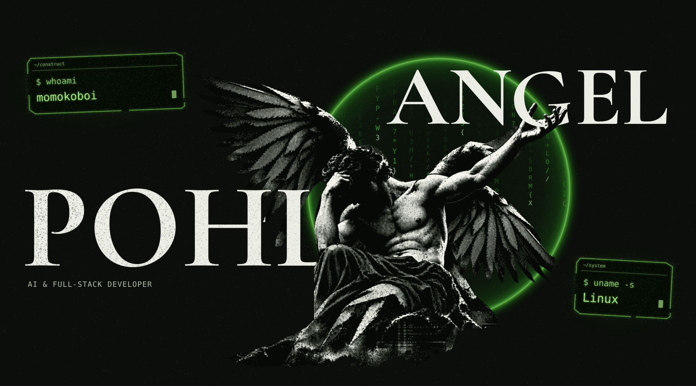
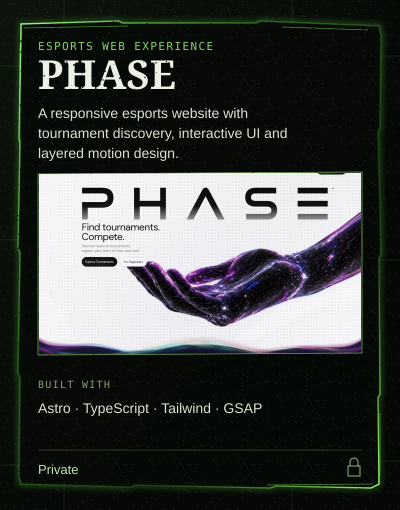
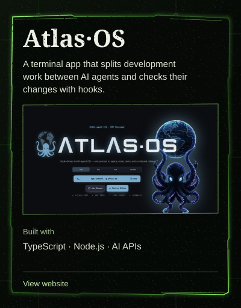
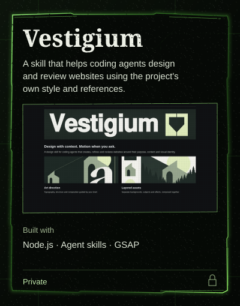
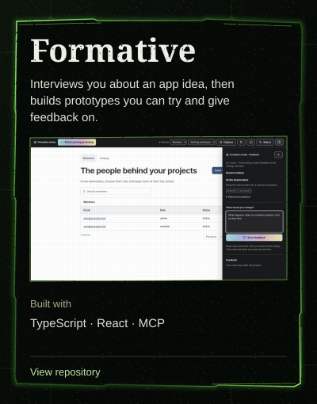

  

  I build websites and tools for coding agents. 
  Deutsch · English · Português

<h2 align="center">
  
</h2>

  
  

  
  

<h2 align="center">
  
</h2>

  
  
  

More projects &amp; background

### Other public work

- [N.E.X.U.S-ML](https://github.com/lucapohl-angel/N.E.X.U.S-ML) — Python, OpenCV and Tesseract pipeline for extracting structured match data from screenshots.
- [Tournament-APP](https://github.com/lucapohl-angel/Tournament-APP) — Mobile Legends references and analysis tools for tournament casters.
- [FlameTheory demo](https://github.com/lucapohl-angel/Brugers) — completed restaurant website demo; the original client project is no longer active.

### Tools I work with

| Area | Tools |
| --- | --- |
| Web & UI | TypeScript, React, Astro, Next.js, Tailwind CSS, GSAP |
| Backend & data | Node.js, Python, REST APIs, PostgreSQL, Supabase |
| AI workflows | Agent tooling, reusable skills, OpenAI / OpenRouter integrations, n8n |
| Delivery | Git, Linux, Docker, Nginx, SSH |

### Background

Previous work in IT support and onsite rollout. Four semesters of Cyber Security Management at Hochschule Niederrhein.

